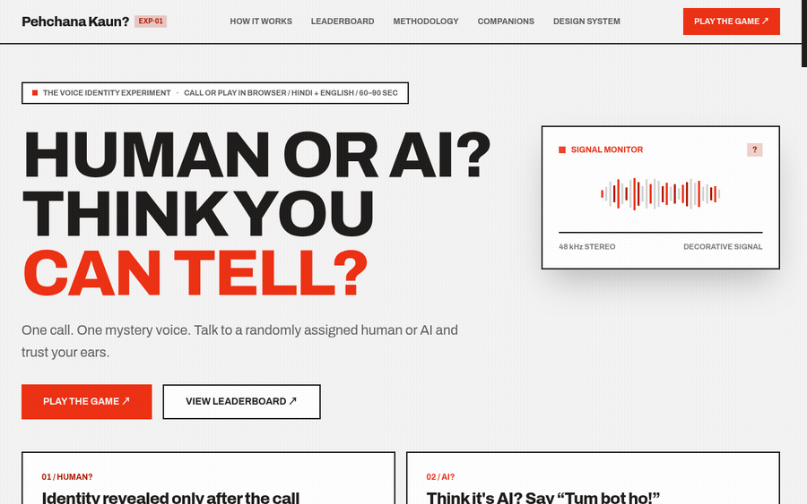
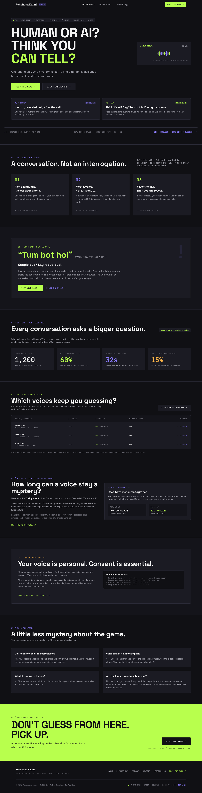
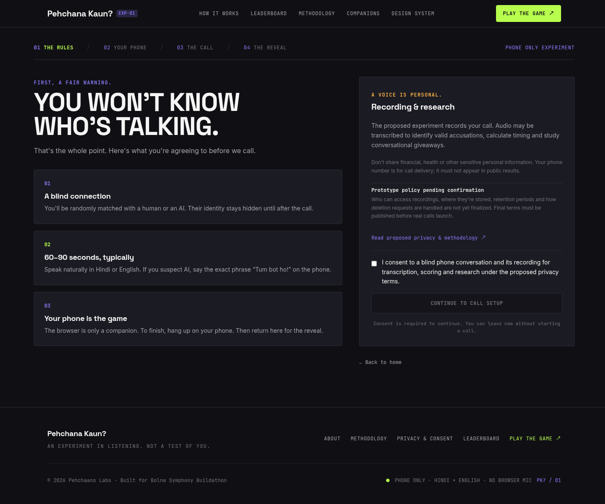
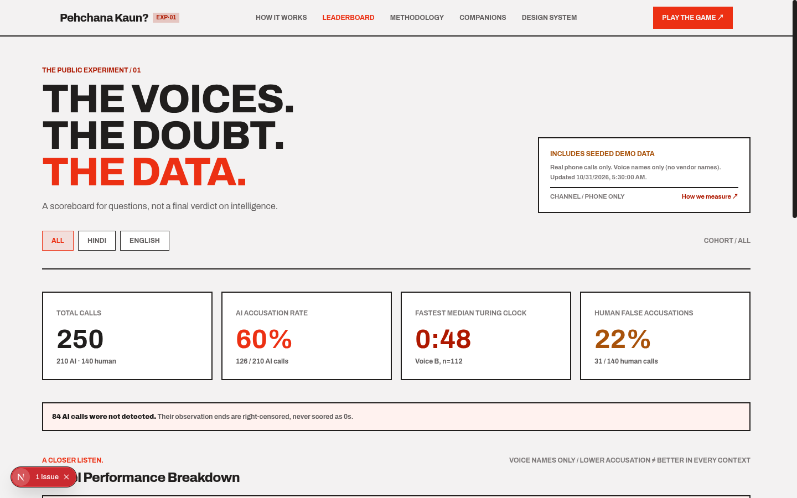
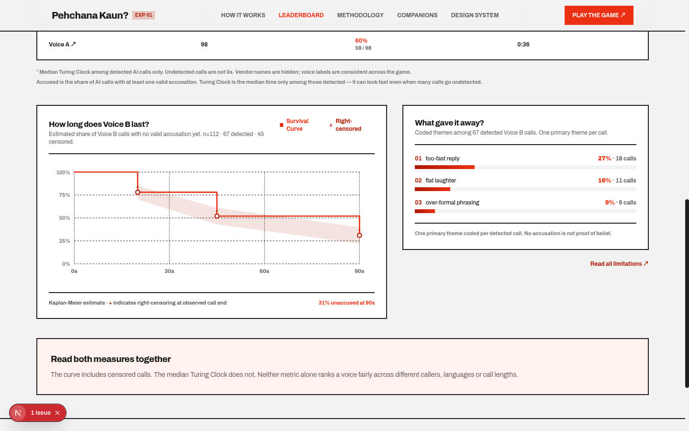
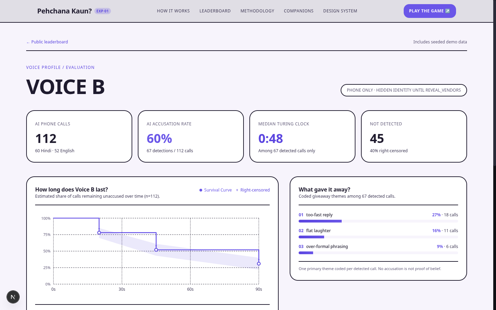
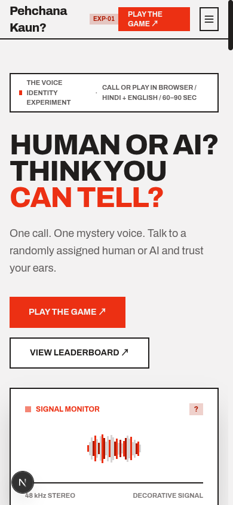

<div align="center">

# Pehchana Kaun?

**India's first public phone-line Turing test for voice AI.**

[](https://web-ten-mu-42.vercel.app)
[](LICENSE)
[](web/package.json)
[](backend/pyproject.toml)
[](web/tsconfig.json)
[](https://bolna.ai)
[](https://deepgram.com)
[](https://www.bolna.ai/symphony/buildathon)

Call a number, chat for two minutes, and the moment you think you're talking to a bot, say
*"tum bot ho!"*. Sometimes it's a real person, sometimes it's an AI voice agent. We measure
how many seconds each AI voice survives before a real Indian caller catches it, what gave
it away, and how that changes by language.

[**▶ Play it live**](https://web-ten-mu-42.vercel.app) · [View the leaderboard](https://web-ten-mu-42.vercel.app/leaderboard) · [API health](https://pehchana-api.onrender.com/healthz)



</div>

Built by **Pehchaano Labs** (team of 3) for the
[Bolna Symphony Buildathon](https://www.bolna.ai/symphony/buildathon)
(submissions close **31 Oct 2026**; finale 20 Nov 2026, Bengaluru).

> **Status: built and deployed.** Routing, three AI voice arms (Kalpa / Cartesia / Sarvam),
> detection, giveaway tagging, and the public leaderboard are live. The browser-call path
> works end to end against production. The dial-in phone number is wired up but outbound
> calls from our Plivo account to Indian numbers are currently geo-barred by Plivo — pending
> their support. Start with [docs/plan.md](docs/plan.md).

## How it works

```
caller ──► Plivo number ──► our router (FastAPI) ──► one random arm
                                │                     ├─ human volunteer (control)
                                │                     └─ AI arm = Bolna agent
                                │                        (Kalpa / Cartesia / Sarvam voice)
                                ▼
                 stereo recording ──► Deepgram ──► "tum bot ho" detector ──► Turing Clock
                                                                  └─► giveaway tags (Claude)
                                                                        └─► public leaderboard (Next.js)
```

Details: [docs/architecture.md](docs/architecture.md). Metric definitions:
[docs/metrics.md](docs/metrics.md). Consent and data handling:
[docs/ethics.md](docs/ethics.md).

## A look around

<table>
<tr>
<td width="50%"><br/><sub><b>Landing</b> — the pitch, live stats, and the public scoreboard preview</sub></td>
<td width="50%"><br/><sub><b>Consent</b> — explicit, unchecked by default, explained before any call starts</sub></td>
</tr>
<tr>
<td width="50%"><br/><sub><b>Leaderboard</b> — accusation rate, Turing Clock and censoring, read live from the API</sub></td>
<td width="50%"><br/><sub><b>Evidence</b> — a Kaplan-Meier survival curve plus the giveaway themes that caught each voice</sub></td>
</tr>
<tr>
<td width="50%"><br/><sub><b>Voice profile</b> — per-arm detail, broken down by language</sub></td>
<td width="50%"><br/><sub><b>Mobile</b> — same flat, ink-on-grey, one-red-accent system down to 390px</sub></td>
</tr>
</table>

More: [methodology](screenshots/09-methodology.png) · [connection states](screenshots/10-companions.png) · [design system](screenshots/11-design-system.png)

## Repo layout

| Path | What | Owner |
|---|---|---|
| `backend/` | FastAPI app: telephony webhooks, routing, Bolna callbacks, processing, stats API | all |
| `backend/src/pehchana/arms.py`, `telephony/`, `api/telephony.py` | Call routing and Plivo flow | WS1 |
| `backend/src/pehchana/integrations/`, `detection.py`, `tagging.py`, `pipeline.py`, `api/bolna.py` | Bolna agents, transcription, detection, tagging | WS2 |
| `backend/src/pehchana/scoring.py`, `api/leaderboard.py`, `api/webcall.py` | Stats API and web-call session minting | WS3 |
| `web/` | Next.js 16 site — landing, play flow, leaderboard, methodology, design system | WS3 |
| `bolna/` | Arms config, agent template, `accuse_bot` function, personas | WS2 |
| `docs/` | Context, architecture, plan, metrics, ethics, deploy, pitch | all |
| `docs/research/` | Full research notes with source links (hackathon, Bolna, judges, sponsors, competitors) | read-only |
| `screenshots/` | Current site screenshots and the demo GIF used in this README | — |
| `render.yaml`, `Dockerfile` | Backend deploy (Render, Docker) | WS1 |

## Quickstart (run it yourself)

Prereqs: Python 3.12+ with [uv](https://docs.astral.sh/uv/), Node 20+ with pnpm,
Docker (optional, for Postgres).

```bash
cp .env.example .env          # fill in what you have; everything is optional for local dev
make setup                    # uv sync + pnpm install
make dev-api                  # http://localhost:8000/docs  (SQLite by default)
make dev-web                  # http://localhost:3000
make check                    # lint + types + tests, same as CI
```

Plivo and Bolna need to reach your laptop: run a tunnel (`cloudflared tunnel --url
http://localhost:8000` or `ngrok http 8000`) and set `PUBLIC_BASE_URL` to it.

## Team workflow

Read [CONTRIBUTING.md](CONTRIBUTING.md). Short version: branch from `main`, small PRs,
signed commits, CI green, one review from another workstream before merge.

## Credits

"Turing Clock" is [Kalpa Labs' proposed metric](https://kalpalabs.ai/blog/towards-generalist-audio-models)
(how long a person can talk to a model before reliably telling it's an AI). This
project builds a public, phone-based version of it for Indian languages.

## License

[MIT](LICENSE) © 2026 Pehchaano Labs
