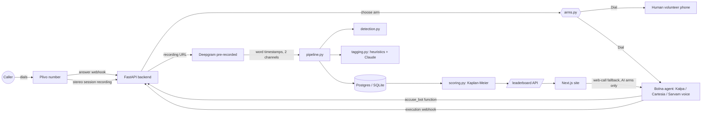

# Architecture

## Components

## Call flow

1. Caller dials the Plivo number. Plivo POSTs `/telephony/plivo/answer`.
2. Backend verifies the Plivo signature, hashes the caller number, creates a `Call`,
   picks an arm (`arms.eligible_arms` then `arms.choose_arm`), and returns XML:
   - consent notice (`<Play>` of a hosted mp3, or `<Speak>` fallback),
   - `<Record recordSession="true" startOnDialAnswer="true" redirect="false"
     recordChannelType="stereo" callbackUrl=".../recording?call_id=...">`,
   - `<Dial action=".../dial-status?call_id=...">` with the arm's number(s).
3. The arm answers. For AI arms that is a Bolna agent's inbound number; the agent plays
   the persona. When the caller accuses it, the LLM calls `accuse_bot`, which hits
   `/bolna/fn/accuse`; we log it and return the reveal line.
4. Hangup: Plivo POSTs `/dial-status` (answered, duration) and later `/recording`.
   Bolna POSTs `/bolna/webhook` several times; on the terminal one we attach latency,
   interruption and cost data to the call.
5. `/recording` queues `pipeline.process_call`: Deepgram on the stereo file, detector
   on the caller channel, giveaway tags, `status=processed`.

## Timing: why we transcribe the recording ourselves {#timing}

- Bolna's `transcript` is plain `speaker: text` lines with **no timestamps**, and
  `tool_call_logs` is always empty in API responses.
- The human control arm never touches Bolna at all.
- So the clock comes from one place for every arm: the Plivo stereo recording, which
  starts the moment the arm answers (t = 0). Deepgram gives word timestamps per
  channel; the first accusation in the caller channel is the event time.
- The live `accuse_bot` hit is a backup signal for AI arms (server receive time minus
  `answered_at`) and powers the in-call reveal.

## Routing rules {#routing}

- Phone: an arm needs at least one dial number. Web: AI arms with a Bolna agent id only.
- Human arm: only inside `live_hours` in `bolna/arms.yaml`, unless the admin shift
  override (`/admin/shift`) forces it on or off.
- Choice is random but balanced: weight divided by (1 + recent calls for that arm), so
  arms get similar sample sizes even with ~100 calls.
- Nobody available: `busy_xml()` ("call again in a few minutes").

## Linking a Plivo call to its Bolna execution

Bolna executions don't carry our call id. Match on (arm's agent id, caller number
hash, time window). Get the exact field names from a real webhook on Day 2 and write
them down here.

## Trust boundaries

| Inbound | Check |
|---|---|
| Plivo webhooks | `X-Plivo-Signature-V3` (fail closed) |
| Bolna webhook + `accuse_bot` | shared-secret bearer token configured on the agent; optional IP allowlist (13.203.39.153, 13.126.9.249, 13.202.133.53) |
| `/admin/*` | `ADMIN_TOKEN` bearer |
| `/webcall/session` | rate limit per IP; never returns the Bolna key |

## Deploy (to decide on Day 2)

Backend needs a stable public HTTPS URL for Plivo/Bolna callbacks and a Postgres DB.
Web is a plain Next.js app. Pick the simplest host the team already has access to and
write the choice here.

## Day-1 unknowns (verify with a real call, then update this doc)

- [ ] Can we get an Indian inbound number on Plivo without company DLT paperwork?
- [ ] Does Plivo `<Dial>` to a Bolna-hosted number work, and what caller id does Bolna see?
- [ ] Which stereo channel is the caller (`CALLER_CHANNEL`)?
- [ ] Does Deepgram `nova-3` with `language=multi` handle Hinglish + Tamil on 8 kHz call audio?
- [ ] Bolna webhook payload fields for matching (agent id, numbers, timestamps).
